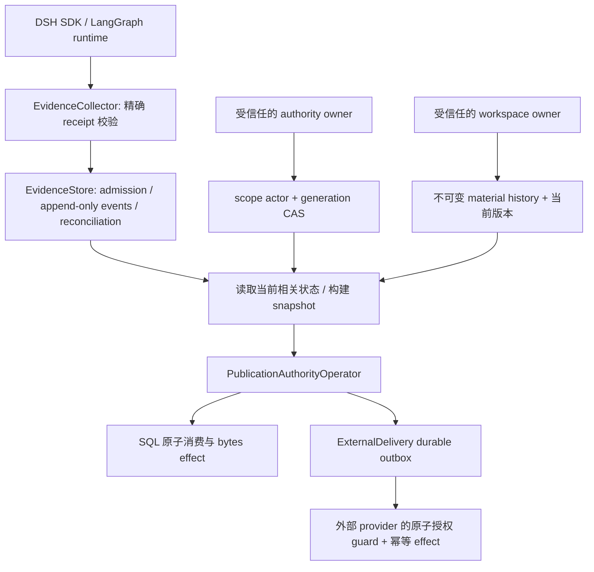

# WTB 执行证据、发布授权与恢复架构

WTB 的执行证据层把 runtime receipt、attempt identity、产物版本和发布批准保存在可核对的持久状态中。它支持 SQLite 与 PostgreSQL，并通过同一个 collector 接入 DeepSeek Harness 和 LangGraph。治理层决定能否消费批准；runtime 仍负责实际模型、工具和工作流执行。

## 分层与职责



| 模块 | 职责 |
|---|---|
| `domain/execution_evidence.py` | 不可变 identity、event、projection 和 EvidenceStore port；严格规范化 JSON，拒绝 NaN、循环和非字符串键 |
| `application/services/evidence_collector.py` | 先核对已 admission 的身份，再精确 reconcile；校验 execution、attempt、input、session、完整 envelope 和 outcome |
| `infrastructure/evidence/sql_store.py` | SQLite/PostgreSQL 共用状态机、事务操作及证据投影 |
| `infrastructure/evidence/sqlite_store.py` | 单机 SQLite 存储；写入与当前 attempt 选择使用 `BEGIN IMMEDIATE` 和 expected-attempt CAS |
| `infrastructure/evidence/postgres_store.py` | 有界连接池、独立事务和 schema advisory lock；多个进程共享同一证据域 |
| `infrastructure/evidence/publication_sink.py` | Policy CAS、material history、批准及事务 effect；产物 bytes 是 sink 实际提交的 effect |
| `domain/interfaces/publication_sink.py` / `external_delivery.py` | 外部 provider port 和持久请求；固定 provider identity、幂等键与 payload，核对未知结果 |

原生 message/checkpoint ID 单独保存。缺失原生 ID 时，collector 不会从路径或拼接字符串制造证明。应用仍须可信地提取产物、提供 scope、逻辑 mutation 和变更前后摘要，并限制谁能调用 authority-owner 与 workspace-owner 端口。Hash 不是签名，执行收据也不会自动成为授权。

## 事件与批准的不变量

| 风险 | 执行规则 |
|---|---|
| 晚到旧 attempt 覆盖新执行 | 精确查询 `(execution, attempt)`；head 只由 admission CAS 更新；旧 attempt 完成或重复注册不改 head |
| 重试重写旧身份 | Identity 不可变；重复注册必须完全相同，scope/runtime/envelope 不同则拒绝 |
| 完成后收到 running，或收到相反的 terminal 记录 | 事件集合采用顺序无关投影；相互冲突的 terminal 记录进入 unknown，不能自动选最新一条 |
| 同 event ID 对应不同内容 | 不只按 ID 去重；保留不同内容摘要并把冲突投影为 unknown |
| 旧核对覆盖新故障 | Resolve 携带 expected revision；新事实使旧核对失效 |
| 应用后续修改原始 dict | 规范 JSON 持久化，读取返回分离对象；嵌套 Mapping 同样规范化 |
| 收据绑定错配 | Execution、attempt、input、session 和 envelope 均须匹配已 admission 身份 |
| 无关 scope 更新或撤权再授予 | 只读取 mutation 涉及的 policy；无关更新不阻止消费，相关 generation 变化使旧批准失效 |
| 读取后、effect 前发生更新 | 消费事务重新读取 policy、head、events 和 material；所有相关写者使用相同事务边界 |
| 相同 bytes 被重新记录为新 material | 每次 `record_material` 增加存储 generation；批准绑定该 generation，详见[升级说明](e1-material-version-upgrade.md) |
| 重复调用、进程崩溃或并发消费 | 同一批准只提交一个新的本地 effect；已提交结果可幂等重放 |
| 缓存沿用旧批准或当前状态 | 仅缓存不可变解码与 frozen snapshot；每次消费重新读取相关事实，完整缓存键包含核对结果 |

## DSH / Cordis 与 LangGraph

WTB 保持如下调用链，不访问 Cordis 内部 service 作为 WTB API：

```text
WTB governance
  -> WorkflowRuntime / DeepSeekHarnessRuntime
    -> DeepSeek Harness Python SDK
      -> JSON-RPC runtime
        -> Cordis agent composition
```

DeepSeek Harness 管理 model/session、agent loop、工具及 Cordis lifecycle。WTB 管理 execution/attempt identity、durable admission、recovery policy、workspace/checkpoint/CAS evidence、evaluation 和 audit。完整 adapter 的 S0/M0 引用能力要求匹配的 source SDK；`deepseek-harness-source` extra 只安装 Python prerequisite，不提供兼容 SDK。安装与协议要求见 [DeepSeek Harness 集成](../DEEPSEEK_HARNESS.md)。已发布 SDK 或只支持基本 durable-attempt 的 checkout 不能视为完整接口的替代品。

DSH 的恢复能力以 exact durable attempt 和已验证 terminal receipt 为依据；它不声明 checkpoint rewind 或 fork 能力。Observation/session 不等于文件系统隔离或可回退 checkpoint。LangGraph adapter 保留原生 checkpoint ID，且使用 process-local provider identity；新建 adapter 不会仅凭相同路径推断 runtime 连续性。

共同 collector 流程为 prepare → admission → invoke → exact reconcile → receipt 校验 → execution projection。证据库重开只能恢复已保存的 WTB 证据，不会扩大底层 runtime 的恢复能力。

## 消费与外部恢复

本地 SQL effect 的提交点是事务 commit；重复消费返回此前结果，不产生新 effect。Material history 与 event history 追加记录；policy、head 和 current-material 独立保存当前状态。相关 generation 在存储层原子递增，调用方不自行计算下一版本。SQLite effect 是数据库存储的 bytes，不包括事务外文件写入。

`ExternalDelivery` 在调用 provider 前持久化请求并消费本地批准。Provider identity 不可换绑，同一请求保留固定幂等键与 payload。进程丢失、超时或回包丢失都可能产生 unknown；普通 dispatch 对已记录请求只做 lookup，不能把 absent 自动当作安全重发。显式 `retry_absent` 要求 authoritative absence 和本地新鲜授权，并继续使用原幂等键。

外部 provider 必须在实际 effect 时原子检查当前 authority token、幂等键和 effect。WTB 的 SQL 事务不会为任意 Git push 或 HTTP API 提供 exactly-once 保证；缺少这些能力的 provider 需要如实声明其语义。`EvidenceError.code` / `recovery` 和 `ExternalOutcome.recovery` 提供查询、重绑定或重新授权的线索，恢复提示不扩大调用者权限。

PostgreSQL 配置、锁和池生命周期见 [PostgreSQL 接入](POSTGRES_EVIDENCE_ZH.md)。这与 LangGraph PostgreSQL checkpointer 是不同服务。

## 验证入口

从仓库根目录安装测试依赖并运行确定性合同与真实进程崩溃测试：

```sh
python -m pip install -e ".[dev]"
python -m pytest -q tests/unit/evidence tests/unit/test_action_authority_operator.py tests/unit/test_publication_authority_operator.py tests/integration/test_publication_sink_crash.py tests/integration/test_external_delivery_crash.py
python -m pytest -q tests/integration/test_evidence_collectors_real.py
```

第二条 runtime collector 检查需要对应可选依赖。DSH 检查使用真实 Python SDK、JSON-RPC 子进程、Cordis loader、持久 session/attempt 和 native message ID；模型传输由本地确定性 HTTP server 提供，无需付费 provider。按照 [DSH 前提与环境变量](../DEEPSEEK_HARNESS.md) 配置完整 source checkout；设置 `WTB_REQUIRE_DSH_REAL_E2E=1` 可把缺失前提变成失败。缺失依赖导致的 skip 不能记作通过。

开发脚本可生成当前环境的核对与 profiling 结果；它们需要仓库测试依赖，生产包不导入 tests：

```sh
python scripts/compare_evidence_lifecycle.py --output paired.json
python scripts/profile_evidence_lifecycle.py --n 600 --output profile.json
python scripts/audit_evidence_integration.py --output inventory.json
```

测量结果只适用于实际运行的依赖、输入和环境；这些脚本不建立跨框架性能或安全性的普遍排序。
